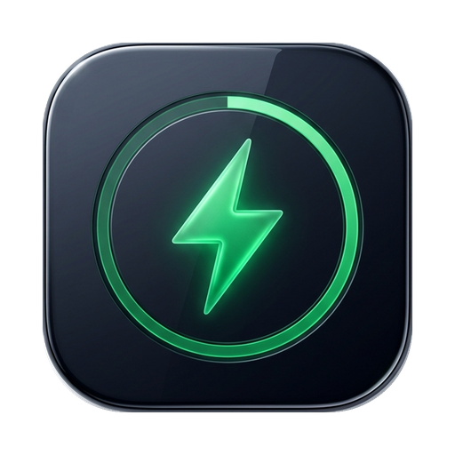
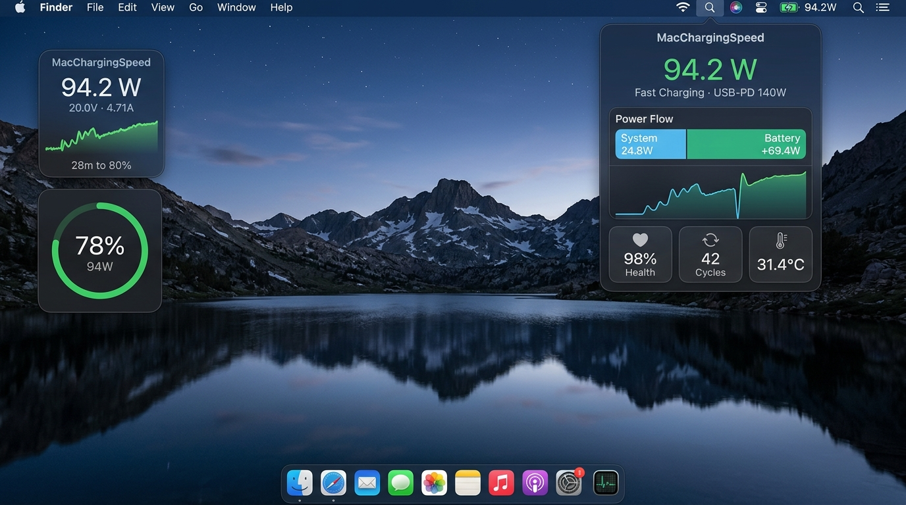
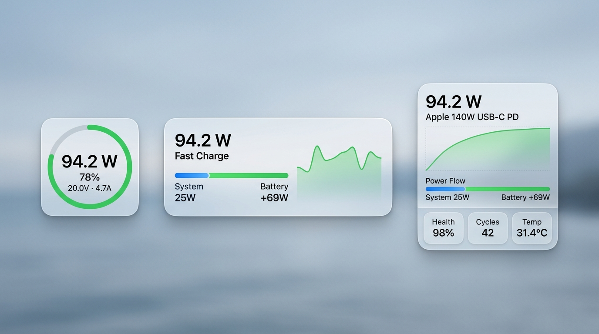
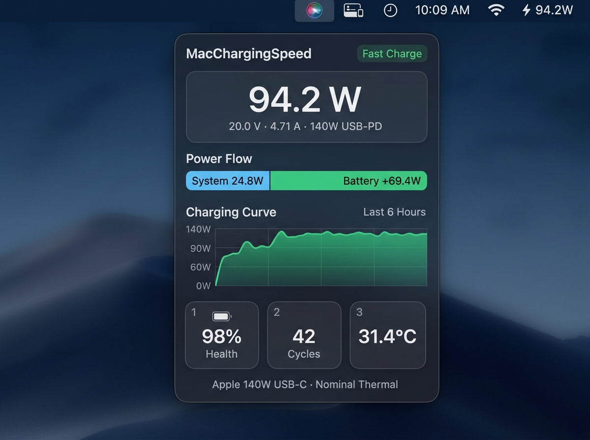
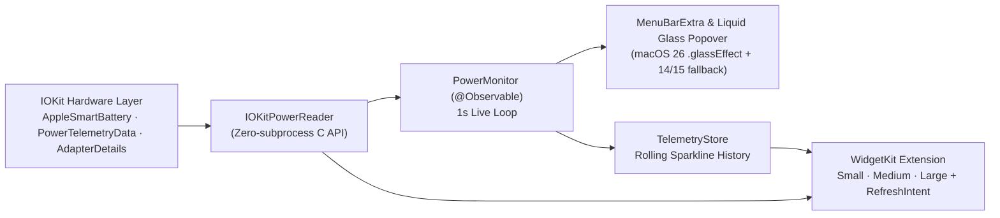

<div align="center">



# MacChargingSpeed

**Native macOS Tahoe Liquid Glass desktop widgets & 1-second live menu bar monitor for Mac power users.**

Inspect real-time charging wattage, voltage, amperage, USB-PD contracts, system-vs-battery power flow, charging curves, cell balance, and battery health directly from IOKit.

<p>
  <a href="https://github.com/CaptainCompileon/mac-charging-speed-widget/actions/workflows/build-macos.yml">
    
  </a>
  
  
  
</p>

<p>
  <a href="#install-on-your-mac">Install on Mac</a> &nbsp;&middot;&nbsp;
  <a href="#desktop-widgets--menu-bar">Screenshots</a> &nbsp;&middot;&nbsp;
  <a href="#power-user-telemetry">Telemetry</a> &nbsp;&middot;&nbsp;
  <a href="#publish-the-landing-page">Landing Page &amp; Vercel</a>
</p>

<br />



</div>

---

## Why MacChargingSpeed?

macOS hides the hardware truth behind a single rounded battery icon. You cannot tell whether your USB-C cable is bottlenecked at 30W, how much of your 140W charger is going to the battery versus the SoC under load, or when thermal throttling slows your charge curve.

**MacChargingSpeed** queries `AppleSmartBattery`, `PowerTelemetryData`, and `AdapterDetails` directly in-process via **IOKit** — zero shell subprocesses, near-zero CPU wakeups — and presents everything in Apple's latest **Liquid Glass** design language.

---

## Desktop Widgets & Menu Bar

### Three Native WidgetKit Sizes

Adaptive **macOS 26 Tahoe Liquid Glass** (`glassEffect` & `GlassEffectContainer`) with automatic hand-tuned specular vibrancy on **macOS 14 Sonoma** and **macOS 15 Sequoia**.

<p align="center">
  
</p>

| Size | Highlights |
| :--- | :--- |
| **Small** | Circular charging progress ring, live watts (`94.2W`), battery `%`, voltage & current (`20.0V · 4.7A`). |
| **Medium** | Hero wattage readout, charging phase badge, **System vs. Battery** Power Flow bar, live wattage sparkline, ETA, and on-demand refresh button. |
| **Large** | Full power-user cockpit: hero watts, USB-PD adapter name & protocol, gridded charging curve with peak marker, Power Flow split, and Health / Cycles / Temperature tiles. |

### 1-Second Live Menu Bar Monitor & Popover

Because macOS throttles desktop widget timelines to save energy, the companion menu bar app updates every second and syncs state changes straight to your desktop widgets.

<p align="center">
  
</p>

---

## Power-User Telemetry

| Metric | Source (`IOKit`) | What It Tells You |
| :--- | :--- | :--- |
| **Live Watts, Volts & Amps** | `Voltage`, `InstantAmperage`, `PowerTelemetryData` | Instantly verify fast charging and catch degraded USB-C cables or weak ports. |
| **Power Flow Split** | `SystemPowerIn`, `SystemLoad`, `BatteryNetWatts` | Separates incoming wall wattage into **Mac System Draw** vs. **Net Battery Charge**. |
| **Charging Curve Sparkline** | Rolling in-memory & persisted timeline | Tracks fast-charge ramp, thermal tapering, and the 80% trickle drop-off. |
| **True Battery Health** | `AppleRawMaxCapacity / DesignCapacity` | Exact chemical health (`%` & `mAh`), cycle count vs. design cycles, and individual cell voltage imbalance (`Δ mV`). |
| **Thermals & Power State** | `Temperature`, `ProcessInfo.thermalState` | Live battery pack temperature (`°C` or `°F`), thermal pressure level, and Low Power Mode state. |
| **USB-PD Adapter Inspector** | `AdapterDetails` / `AppleRawAdapterDetails` | Charger name, manufacturer, USB-PD / EPR protocol, negotiated `V / A / W` contract, utilization %, and serial number. |

---

## Install on Your Mac

### Option 1: One-Command Install (Recommended)

Builds the native app + WidgetKit extension directly on your Mac (Apple Silicon or Intel), installs to `/Applications/MacChargingSpeed.app`, and launches it in your menu bar.

```bash
curl -fsSL https://raw.githubusercontent.com/CaptainCompileon/mac-charging-speed-widget/main/scripts/install.sh | bash
```

> **Requirements:** macOS 14.0+ (Sonoma, Sequoia, or Tahoe 26+), Xcode, and Homebrew (auto-installs `xcodegen` if missing).

### Option 2: Download Prebuilt `.dmg` from GitHub Actions

Every push to `main` compiles a ready-to-install macOS `.dmg` and `.app.zip` on a GitHub-hosted macOS runner:

1. Open the [**Build macOS App & DMG**](https://github.com/CaptainCompileon/mac-charging-speed-widget/actions/workflows/build-macos.yml) workflow.
2. Download the **`MacChargingSpeed-macOS`** artifact from the latest green run.
3. Open `MacChargingSpeed.dmg`, drag **MacChargingSpeed** into **Applications**, and launch it.

> If macOS Gatekeeper warns on first open (ad-hoc signed open-source build), run:
> ```bash
> xattr -dr com.apple.quarantine /Applications/MacChargingSpeed.app
> ```

### Adding the Desktop Widgets

1. Launch **MacChargingSpeed** once from `/Applications`.
2. Right-click anywhere on your macOS desktop and click **Edit Widgets…**
3. Search for **MacChargingSpeed** and drag the **Small**, **Medium**, or **Large** widget onto your desktop or Notification Center.

---

## Architecture



### Build Locally from Source

```bash
git clone https://github.com/CaptainCompileon/mac-charging-speed-widget.git
cd mac-charging-speed-widget
make install    # Generates Xcode project via XcodeGen, builds Release, installs & launches
make open       # Opens MacChargingSpeed.xcodeproj in Xcode
make dmg        # Packages build/MacChargingSpeed.dmg
```

---

## Publish the Landing Page

The repository includes an Apple-style product showcase webpage in [`docs/`](docs/) with a live interactive telemetry simulator.

### Deploy to Vercel (1-Click)

[`vercel.json`](vercel.json) is preconfigured (`outputDirectory: "docs"`). Click below to publish to Vercel with zero extra configuration:

<p>
  <a href="https://vercel.com/new/clone?repository-url=https%3A%2F%2Fgithub.com%2FCaptainCompileon%2Fmac-charging-speed-widget">
    
  </a>
</p>

Or via the Vercel CLI locally:

```bash
npx vercel --prod
```

### GitHub Pages

[`.github/workflows/deploy-pages.yml`](.github/workflows/deploy-pages.yml) automatically deploys `docs/` to GitHub Pages whenever you enable **Settings → Pages → Source: GitHub Actions**.

---

## License

Released under the [MIT License](LICENSE).
